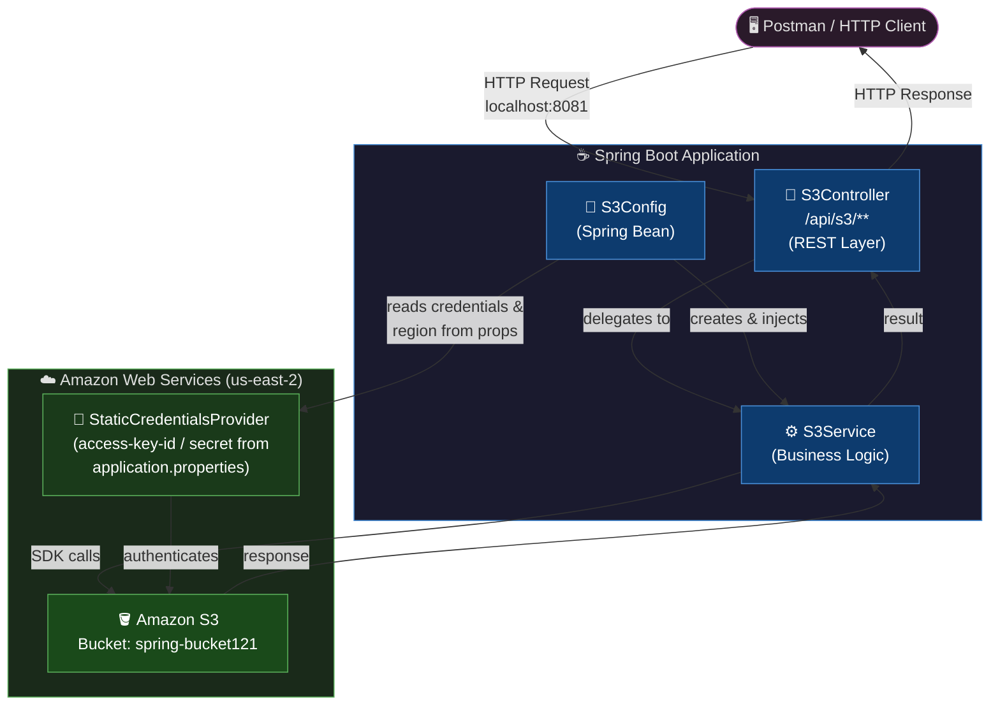
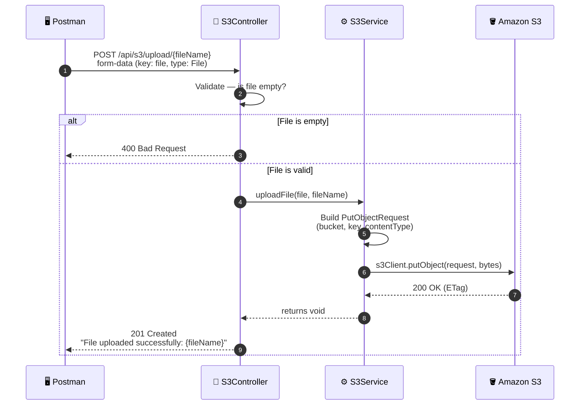
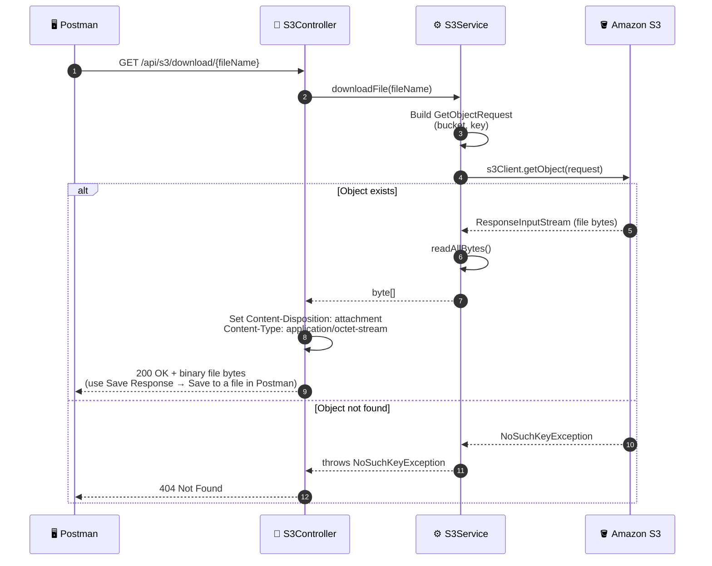
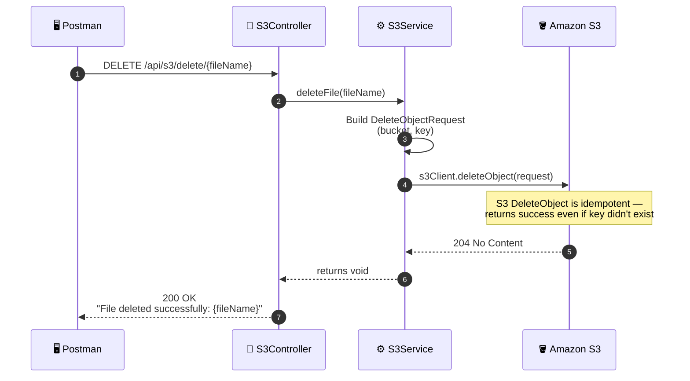

# ☁️ Spring Boot S3 File Management

A clean, beginner-friendly Spring Boot application that provides a REST API to **upload**, **download**, and **delete** files from an Amazon S3 bucket using the **AWS SDK for Java 2.x**.

---

## 📐 Project Architecture



---

## 🌊 Request Flow Diagrams

### 📤 Upload Flow



---

### 📥 Download Flow



---

### 🗑️ Delete Flow



---

## 📋 Prerequisites

| Requirement | Version |
|---|---|
| Java | 21+ |
| Maven | 3.9+ |
| AWS Account | — |
| S3 Bucket | `spring-bucket121` (us-east-2, already created) |
| Postman | Any recent version |

---

## 🔐 AWS & IAM Configuration

### 1. Required IAM Permissions

Your IAM user needs these S3 permissions on the `spring-bucket121` bucket:

```json
{
  "Version": "2012-10-17",
  "Statement": [
    {
      "Effect": "Allow",
      "Action": [
        "s3:PutObject",
        "s3:GetObject",
        "s3:DeleteObject"
      ],
      "Resource": "arn:aws:s3:::spring-bucket121/*"
    }
  ]
}
```

### 2. Credentials Setup

Credentials are supplied directly in `application.properties` using `StaticCredentialsProvider`:

```properties
aws.access-key-id=YOUR_ACCESS_KEY_ID
aws.secret-access-key=YOUR_SECRET_ACCESS_KEY
```


---

## ⚙️ Setup & Configuration

### 1. Open the project
```
d:\SpringBoot_Projects\S3DemoApplication
```

### 2. Fill in `application.properties`

```properties
spring.application.name=S3DemoApplication

# AWS Region where the bucket lives
aws.region=us-east-2

# S3 bucket name
aws.s3.bucket-name=spring-bucket121

# Credentials — fill these in, never commit to Git
aws.access-key-id=YOUR_ACCESS_KEY_ID
aws.secret-access-key=YOUR_SECRET_ACCESS_KEY

# Max upload size
spring.servlet.multipart.max-file-size=50MB
spring.servlet.multipart.max-request-size=50MB

# Port (8080 is in use on this machine, using 8081)
server.port=8081
```

### 3. Run the application

```bash
# Windows
mvnw.cmd spring-boot:run
```

The server starts on **`http://localhost:8081`**.

---

## 🔌 API Endpoints — Postman Guide

### Base URL: `http://localhost:8081/api/s3`

| Method | Endpoint | Description |
|--------|----------|-------------|
| `POST` | `/upload/{fileName}` | Upload any file to S3 |
| `GET` | `/download/{fileName}` | Download a file from S3 |
| `DELETE` | `/delete/{fileName}` | Delete a file from S3 |

---

### 📤 Upload a File

**`POST /api/s3/upload/{fileName}`**

| Postman Field | Value |
|---|---|
| Method | `POST` |
| URL | `http://localhost:8081/api/s3/upload/photo.jpg` |
| Body tab | `form-data` |
| Key | `file` (change type from **Text** → **File**) |
| Value | Select your file |

> Works with **any file type** — `.jpg`, `.png`, `.pdf`, `.zip`, `.mp4`, etc.

**Success Response — `201 Created`:**
```
File uploaded successfully: photo.jpg
```

**Error Responses:**

| Status | Cause |
|--------|-------|
| `400 Bad Request` | No file selected / file is empty |
| `500 Internal Server Error` | AWS error or I/O error |

---

### 📥 Download a File

**`GET /api/s3/download/{fileName}`**

| Postman Field | Value |
|---|---|
| Method | `GET` |
| URL | `http://localhost:8081/api/s3/download/photo.jpg` |
| Body | None |

> After hitting **Send**, click **Save Response → Save to a file** to get the actual file on disk.
> The response body will look like garbled binary in Postman's viewer — that's normal for image/binary files.

**Success Response — `200 OK`:**
- Body: binary file content
- Header: `Content-Disposition: attachment; filename="photo.jpg"`

**Error Responses:**

| Status | Cause |
|--------|-------|
| `404 Not Found` | File does not exist in S3 |
| `500 Internal Server Error` | AWS error or I/O error |

---

### 🗑️ Delete a File

**`DELETE /api/s3/delete/{fileName}`**

| Postman Field | Value |
|---|---|
| Method | `DELETE` |
| URL | `http://localhost:8081/api/s3/delete/photo.jpg` |
| Body | None |

**Success Response — `200 OK`:**
```
File deleted successfully: photo.jpg
```

> 💡 S3's `DeleteObject` is idempotent — deleting a non-existent file still returns success (standard AWS behaviour).

**Error Responses:**

| Status | Cause |
|--------|-------|
| `500 Internal Server Error` | AWS error |

---

## 📁 Project Structure

```
S3DemoApplication/
├── src/
│   └── main/
│       ├── java/com/panduranga/S3DemoApplication/
│       │   ├── S3DemoApplication.java      ← Spring Boot entry point
│       │   ├── config/
│       │   │   └── S3Config.java           ← S3Client bean (StaticCredentialsProvider)
│       │   ├── service/
│       │   │   └── S3Service.java          ← Upload / download / delete logic
│       │   └── controller/
│       │       └── S3Controller.java       ← REST endpoints
│       └── resources/
│           └── application.properties      ← AWS region, bucket, credentials & port
├── pom.xml                                 ← Maven dependencies (AWS SDK BOM included)
└── README.md
```

---

## 📦 Key Dependencies (`pom.xml`)

| Dependency | Purpose |
|---|---|
| `spring-boot-starter-webmvc` | Spring MVC + embedded Tomcat |
| `software.amazon.awssdk:bom:2.55.16` | AWS SDK BOM — manages all transitive deps |
| `software.amazon.awssdk:s3` | S3 client (version from BOM) |

---

## 🔒 Security Notes

- ⚠️ Keys are in `application.properties` for local development — **never push this file to Git**
- Add `application.properties` to `.gitignore` before committing:
  ```
  src/main/resources/application.properties
  ```
- For production, use **IAM Roles** (EC2/ECS/Lambda) — no keys needed at all

---

## 🐛 Common Issues

| Problem | Solution |
|---------|---------|
| `Port 8080 already in use` | Set `server.port=8081` in `application.properties` |
| `ClassNotFoundException: S3Client` | Run `mvnw.cmd clean spring-boot:run` to clear stale classes |
| `NoSuchBucketException` | Verify `aws.s3.bucket-name=spring-bucket121` matches exactly (no trailing spaces) |
| `403 Forbidden` | IAM user is missing `s3:PutObject` / `s3:GetObject` / `s3:DeleteObject` permissions |
| `Region mismatch` | Ensure `aws.region=us-east-2` matches the bucket's actual region |
| File size error | Increase `spring.servlet.multipart.max-file-size` in `application.properties` |
| Binary gibberish in Postman download | Normal — use **Save Response → Save to a file** instead |

---

## 📄 License

This project is for demonstration and learning purposes.
